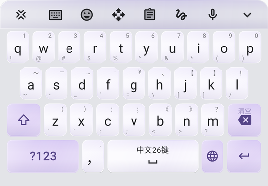
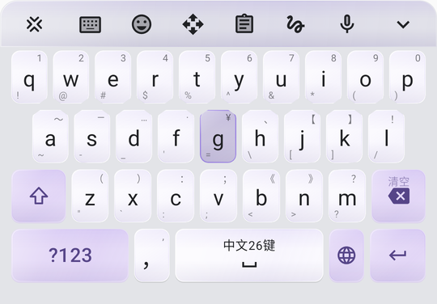
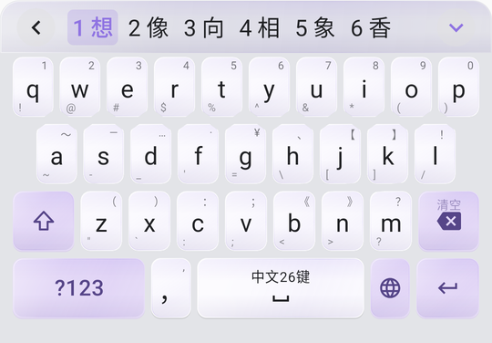

# Lime 2.01.00 · 概率键盘

**26 个字母使用独立键帽，并裁入原高斯概率的优势区域；点在可见键帽内时，本键就是最大触摸概率项。**



Lime 是一个 Android 中文 / 英文 / 日文输入法。2.00 系列是键盘输入模型的一次大改版：字母区外观沿用 Xime 的传统圆角键帽，便于定位；但触点不会被硬判成“按中了哪个键”，而是先变成 26 个字母上的概率分布，再和用户习惯、通用词表一起算出一个最终概率，把概率最高的字词放在候选第一位。概率密度本身不再用颜色深浅画在键面上。

Lime 是 [Xime](https://github.com/ximeiorg/Xime) 与 [CyIME](https://github.com/Cyletix/CyIME) 的 fork：
**输入底层完整采用 CyIME**，**键盘外观与交互设计沿用 Xime**。

## 「概率汤」在哪里

传统键盘的每个按键都是一个独立开关：手指落在 `g` 的格子里就只可能是 `g`。可真实的手指从来不是精确落在格子中央的，于是只能靠一套很复杂的纠错算法去猜“用户到底想打 `xiang` 还是 `xian'h`”。

Lime 保留了概率采样，但不再把密度画成“概率汤”：

- **键帽与最大触摸概率对齐。** 高斯分布不变；可见字母帽由原圆角形状与其高斯优势区相交得到，交错行边角也不会越入邻键更有可能的区域。相邻最大概率的等值线位于帽间缝隙中；概率本身仍连续交叠，不被键帽硬切断。
- **点按不是“按下某个键”，而是一次采样。** 触点同时得到 26 个字母的概率；密度最高的字母作为本次输入，其他相邻字母把它相对最高字母的对数概率交给解码器。
- **概率不显示在键面上。** 字母帽保留圆角风格，按原高斯优势区裁切；功能键外观不变。不绘制密度色块、概率光晕或分格线。零/极窄间距下仍留必要的抗锯齿细缝，按压回弹也不会越过概率分界。
- **所有语言都使用同一套采样。** 中文全拼、英文、日文罗马字、西班牙语等，只要使用标准 26 键字母排布，触点都会进入概率采样；功能键、候选栏、工具栏、空格、删除、`?123`、回车保持原来的位置和行为。
- **不是“猜错字”，而是把概率乘进去。** 中文全拼的候选分数从原来的词频排序，变成
  `P(词 | 用户习惯, 通用词表) × P(触点序列 | 字母序列)`。
  用户越常用某个词，它在用户词库里的权重越高；触点越支持某个拼写，它的概率越高；两者一起决定第一名。

按住 `g` 时的真实截图：键帽只显示普通按压状态；颜色不再表示概率深浅，但后台采样仍会计算 `g` 及其相邻字母的分布。



## 它怎么算

1. **触点 → 26 个概率**
   每个字母是一个以它传统位置为中心、以键宽/键高归一化的高斯峰。触点 `(x, y)` 对字母 `c` 的密度是
   `exp(-(((x-cx)/w)² + ((y-cy)/h)²)/(2σ²))`，`σ = 0.45`。触摸、裁切与解码器邻接数据使用同一份键盘局部测量，悬浮旋转不再使用根坐标包围框来近似。
2. **输入字母 → Rime**
   密度最高的字母作为本次输入；同时把每个相邻字母相对它的对数概率
   `log P(letter | touch) - log P(typed | touch)`
   写进 Rime 的 `cyime_spatial` 属性。
3. **音节图 → 候选分**
   Rime 的拼音音节图把替换读成带可信度的纠错边，可信度就是上一步的对数概率；词的最终分数是
   `log P(词 | 通用词表, 用户词库) + log P(触点序列 | 字母序列)`。
   整句重排时触点项同样参与，但打中的那串字母是锚点：落在两键之间的一次触点可以改一个音节；手指落在键的中央，或者一句里要同时改好几个字母时，保持打出来的那句。纠正仍然留在后面的候选里。
4. **概率最高的排第一**
   中文全拼按合成分数从高到低列出候选。用户词库、`rime_ice` 通用词表、`librime-octagram` 词模型的原有权重全部保留。

一个具体例子：打完 `xian`，最后一下点在 `g`、`h` 两个键帽之间的等概率线上。

- 传统键盘：先判成 `h`，再靠复杂的纠错规则猜要不要改成 `g`。
- 概率键盘：缝隙中的边界处 `g` 和 `h` 密度相同；按稳定顺序取 `g` 时，输入就是 `xiang`，`h` 仍保留软概率。若点在可见 `h` 帽内部，则本次最大触摸概率及发送字母均为 `h`，不会视觉点H却因空间分布直接发送G。词模型仍可对候选拼写重新排序，这是另一层概率。



英文、日文罗马字等语言同样使用这套概率采样选字母；中文全拼把触点概率送进 Rime 候选排序。日文、假名九键等保留各自方案的候选引擎，概率采样负责选出并发送概率最高的字母。

## 其他特色

- **中日英三语，一键循环**：启用日语后，语言键按「中 → 英 → 日 → 中」循环；只启用中英时保持原来的中英互切。
- **两种日语键盘**：26 键罗马字（`japanese`）与九宫格假名（`japanese_kana`），都走 CyIME 的 Rime 日语方案，支持假名组成、转换预览与汉字候选。26 键罗马字同样使用概率采样。
- **Xime 的键盘外观**：底排是 `?123`、逗号、空格、地球、换行；`?123` 点按回到上次的数字/常用符号页，长按可选页；菜单为四列分页网格；内置 Xime 的 22 套配色主题。
- **退格直接删字**：提交文字后的联想词不再吞掉第一次退格。
- **输入事务安全**：所有输入动作经统一 FIFO 与编辑器归属校验，切换输入框或方案时不会把结果写进错误的编辑框。
- **可复现构建**：词典按固定版本与 SHA-256 下载校验，原生库与 Rime 补丁随仓库固定。

## 兼容性

概率采样作用于**标准 26 键字母区**。分体键盘、14 键、双拼、注音、蜂窝排列、自定义字母排列、九键、假名九键、手写/语音仍使用原来的实体按键界面和交互，功能键和候选栏的行为不变。标准 26 键的字母区和功能键统一显示为圆角键帽。

- 中文全拼：触点概率进入 Rime 候选排序。
- 英文、日文罗马字、西班牙语等：后台采样选出并发送概率最高的字母，候选由各自方案的引擎给出。
- 中文关闭「邻键纠错」时回到传统按键，不做该概率排序；启用概率采样的标准26键才使用上述优势区键帽约束。

实现位置：

- `app/src/main/java/com/kingzcheung/xime/keyboard/SpatialCosts.kt`：高斯触点模型、相对对数概率、候选字母采样、日文罗马字展开时的对齐保护；
- `app/src/main/java/com/kingzcheung/xime/keyboard/GaussianKeyBoundary.kt`：不改高斯公式，为实际宽高（含像素取整差异）构造保守优势区；
- `app/src/main/java/com/kingzcheung/xime/ui/keyboard/GaussianKeyCap.kt`：原圆角帽与优势区相交，动画层外裁切与抗锯齿安全缝；
- `app/src/main/java/com/kingzcheung/xime/ui/keyboard/ProbabilityField.kt`：同一键盘局部坐标的完整26键注册、采样与邻接发布；不绘制密度色块；
- `app/src/main/java/com/kingzcheung/xime/ui/keyboard/KeyboardLayout.kt`：标准 26 键语言使用普通圆角键帽并启用底层概率采样，功能键保持原样；
- `patches/cyime-librime.patch`：Rime 侧把触点概率并入音节图权值，并在整句重排时保留触点项。

## 构建

需要 JDK 17+、Android SDK 平台 37（`platforms;android-37.0`）、NDK `29.0.14206865`。本仓库在 NixOS 上用 `nix-shell` 提供工具链：

```bash
# 完整四个 ABI 的 Debug 包
./gradlew assembleDebug

# 只在 arm64 手机上验证时，可只出 arm64（可选）
./gradlew -PmigrationArm64Only=true assembleDebug
```

首次启动或改动方案配置后会部署中日词典，真机上可能需要几分钟；期间键盘会显示「正在加载词库」，完成前按键不会补输入。

## 致谢

- [Xime](https://github.com/ximeiorg/Xime)（Kingz Cheung / kingzcheung 及贡献者）——本项目的键盘外观、布局、配色与交互设计来源，也是 CyIME 的上游。
- [CyIME](https://github.com/Cyletix/CyIME)（Cyletix 及贡献者）——本项目的输入运行时：Rime 接入与 JNI、输入命令队列、编辑器归属、候选发布、方案与语言模型、T9、插件框架，以及完整的日语 Rime 方案（rime-jaroomaji）。

没有这两个项目，就没有 Lime。感谢作者们的长期投入。

本项目还间接使用了 librime、OpenCC、Boost、雾凇拼音（rime-ice）、rime-jaroomaji、Mozc 词源等开源组件与词库，各自许可见 `app/src/main/assets/NOTICE.txt`、`app/src/main/assets/licenses/` 与各方案目录下的 NOTICE 文件。

## 许可证

本项目沿用上游的 [GPLv3](LICENSE)。上游代码版权归其作者所有，本分支的修改由 Lime 维护者负责。「Xime」「CyIME」的名称与图标不属于本仓库授权范围。
